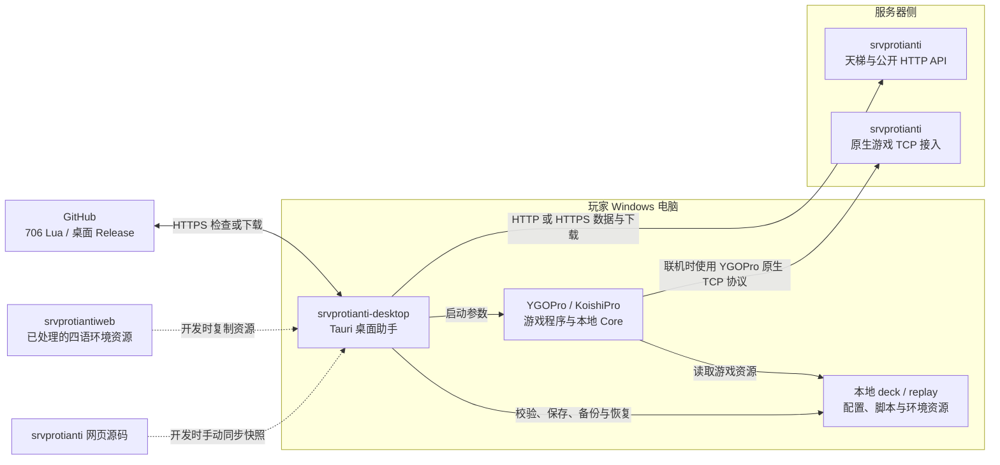
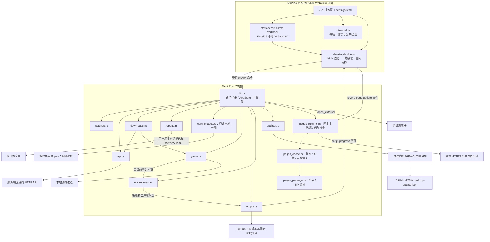
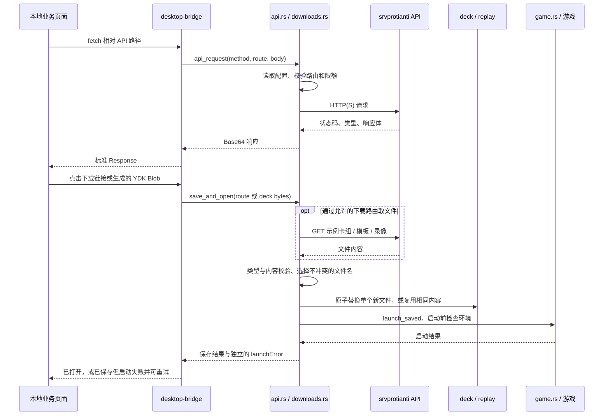
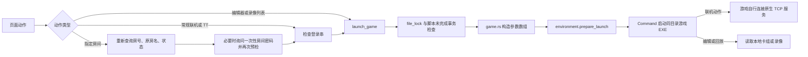
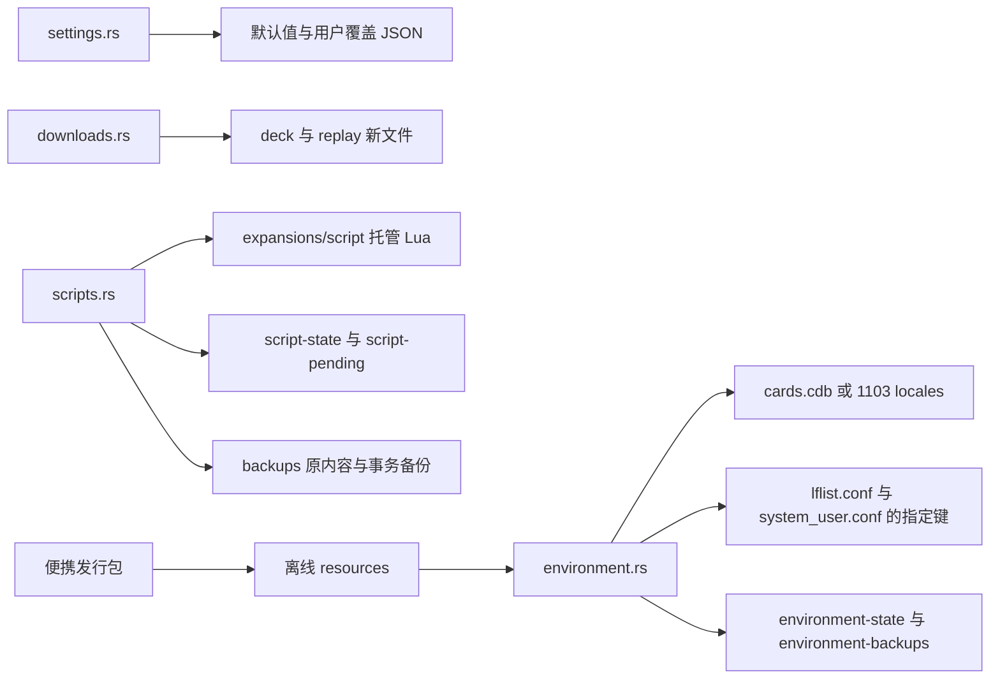
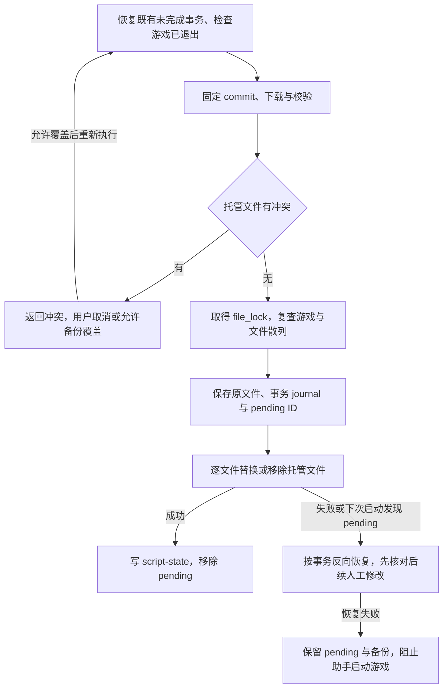
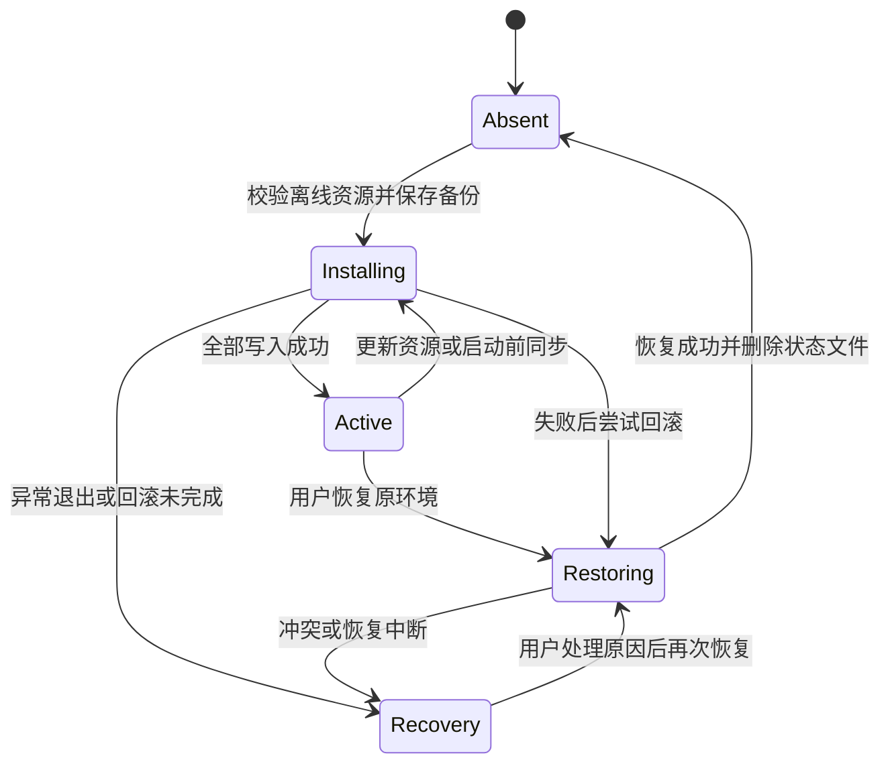
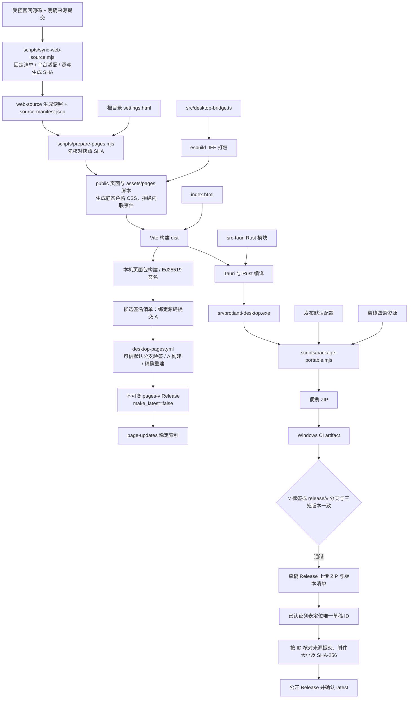

# 桌面助手当前实现架构

更新日期：2026-10-25。应用候选版本 `0.2.0`，签名页面更新与共享页面适配已完成本地构建和 WebView 演练，尚未正式发布；当前生产下载不据此改变。原有游戏/脚本与环境模块职责保持现有实现。构建、WebView 验证与用户实际游戏验收分别记录。

## 1. 文档分工与架构结论

| 文档 | 用途 |
| --- | --- |
| [README](../README.md) | 用户入口、开发命令、便携版使用和发布说明 |
| [DESIGN](../DESIGN.md) | 产品需求、技术取舍、行为契约和验收标准；包含目标项，不能全部当作已完成 |
| 本文 | 当前模块、调用与数据流、文件所有权、构建发布，以及实现与设计的边界 |

当前架构由本地可信页面、Rust 文件/进程操作与服务端统计/认证组成。页面既可来自 exe 内置资源，也可来自独立 HTTPS 发布并通过本机公钥验证的缓存包；同一次运行固定版本和本地 origin。源码按配置、API、下载、启动、脚本更新、环境资源和页面更新组织，更新器分别拥有自己的清单与恢复流程。

页面同步使用显式源目录、固定清单和源/生成散列，平台差异集中在生成器与 Rust 桥接；仍须审核明确的来源提交和交互结果。

## 2. 三个项目中的位置

桌面助手负责展示数据、保存 YDK/YRP、维护玩家本地游戏资源和启动游戏。它不包含对战 Core，不计算天梯统计，也不直接连接服务器数据库。真正的对战连接由被启动的 YGOPro/KoishiPro 发起。



`server.apiBaseUrl` 与 `server.gameHost/gamePort` 是独立配置。桌面页面查询 HTTP API；游戏进程在联机时根据启动参数连接 TCP 服务，卡组编辑和本地录像播放不要求建立这条连接。更改 API 地址不会自动更改游戏目标地址。`srvprotiantiweb` 在这里提供过资源来源，桌面程序运行时不依赖它的网页客户端、WebSocket 链路或浏览器对战运行时。

页面快照位于 `web-source/`；环境资源位于 `src-tauri/resources/environment/1103-201103-v1/`。相邻仓库不是桌面构建命令自动拉取的依赖。页面来源和资源来源分别见 [README](../README.md) 与 [DESIGN 第 14 节](../DESIGN.md#14-1103-环境资源与下载发布补充设计)。

## 3. 运行组件与信任边界



| 源码入口 | 当前职责 |
| --- | --- |
| [src/desktop-bridge.ts](../src/desktop-bridge.ts) | 把原页面 `fetch` 转为 Rust API 调用，接管下载链接和 Blob，绑定桌面动作，保存语言，预检房间 |
| [src-tauri/src/lib.rs](../src-tauri/src/lib.rs) | 确定游戏根目录、初始化设置和共享状态，注册受限本地命令，启动时尝试脚本事务恢复 |
| [settings.rs](../src-tauri/src/settings.rs) | 默认值与用户覆盖值递归合并、字段校验、临时文件替换、整体恢复默认 |
| [api.rs](../src-tauri/src/api.rs) | 方法和路由白名单、请求与响应限额、禁止跟随重定向，返回状态码、内容类型和 Base64 响应 |
| [downloads.rs](../src-tauri/src/downloads.rs) | 来源与内容校验、Windows 文件名处理、同名内容去重、保存并尝试打开 |
| [reports.rs](../src-tauri/src/reports.rs) | XLSX/CSV 另存为对话框，校验建议文件名与 8 MiB 内容上限，仅向用户选择且扩展名匹配的普通文件原子写入；XLSX 另查 ZIP 部件标记、512 部件/32 MiB 展开大小、拒绝宏部件，不自动打开文件 |
| [card_images.rs](../src-tauri/src/card_images.rs) | `read_card_images` 仅接受数字卡号，只读游戏根目录 `pics` 的 jpg/jpeg/png/webp；拒绝目录和文件重解析点，限制每图 2 MiB、每次合计 4 MiB，返回 Base64，不接受任意路径或写文件 |
| [game.rs](../src-tauri/src/game.rs) | 限定同目录 EXE、组合参数数组、调用环境检查，以游戏根目录为工作目录启动进程 |
| [scripts.rs](../src-tauri/src/scripts.rs) | 固定来源 Lua 检查下载、客户端识别、进程检查、冲突检查、清单与事务恢复 |
| [environment.rs](../src-tauri/src/environment.rs) | 离线 1103 资源校验、备份安装、启动时同步语言与服务器、恢复原环境 |
| [updater.rs](../src-tauri/src/updater.rs) | 校验静态版本清单、缓存结果/失败冷却、构造固定 tag 的下载地址；不替换正在运行的程序 |
| [instance.rs](../src-tauri/src/instance.rs) | Windows 上按规范化游戏目录生成互斥体名称，重复启动时激活已有窗口 |
| [webview.rs](../src-tauri/src/webview.rs) | 创建 WebView 前检查 WebView2，缺失时提供原生提示与安装页面入口 |
| [pages_package.rs](../src-tauri/src/pages_package.rs) | 验证签名原始字节、应用/兼容/时效、逐文件清单与 ZIP 内容边界 |
| [pages_cache.rs](../src-tauri/src/pages_cache.rs) | 页面专属缓存、递增 sequence、候选/上一版、启动确认与隔离恢复 |
| [pages_runtime.rs](../src-tauri/src/pages_runtime.rs) | 固定本地协议资源、后台受限 HTTPS 请求、页面状态与原生恢复入口 |

`get_settings`、`save_settings`、`reset_settings`、`set_language` 管理配置；`api_request` 管理数据请求；`launch_game`、`save_and_open`、`open_saved` 管理启动和下载；`script_state`、`update_scripts`、`restore_scripts` 管理脚本；`environment_state`、`install_environment`、`restore_environment` 管理资源；`check_desktop_update`、`open_external` 管理版本检查和外部链接。

卡组详情的单卡投入率使用独立懒加载请求 `GET /api/ladder/deck-detail?view=card-usage`，沿用 v0.2.0 已有的精确 GET 白名单。网页与助手共享单卡板块、数据和 XLSX/CSV 逻辑，按五分区导出；`sync-web-source.mjs` 与页面包来源清单都显式包含 `deck-card-usage.js`。本功能无需扩展 Rust 权限或重发 EXE。

使用率页的单卡“卡组分布”同理复用已放行的 `GET /api/ladder/usage/cards`，以 `view=deck-distribution` 区分；弹窗默认环形图，可切换完整列表，扇区或大号分类按钮只选中，明确的详情按钮再跳转。手机使用近全屏弹窗和固定详情栏，细小扇区通过分类列表选择；返回恢复同时处理重新加载与浏览器返回缓存。逻辑写在 `usage-stats.html` 内，样式在 `common.css`，不新增页面包资源文件，只需同步官网源码并发布页面包，无需改 Rust 白名单或重发 EXE。

页面更新只增加 `page_update_status`、`check_page_update`、`page_ready`、`recover_builtin_pages`。这些命令管理页面缓存，不接受任意更新地址、文件路径或新本地权限；页面业务仍沿用已有 Rust 能力和 API 白名单。

v0.2.2 候选为使用率及卡组详情单卡投入率的图片模式增加 `read_card_images`，由 `desktop-bridge.cardImages` 调用；共享 `card-images.js` 完成网格渲染、显示偏好、本地候选解码、语言图源与英文回退。原生文件读取在线程池中执行。外部图片以 HTTPS `img` 加载，本地内容使用已允许的 data URL，不扩大通用文件访问或任意网络 API 权限。页面包最低应用版本取构建源码的应用版本，新增能力本轮要求至少 v0.2.2；本地实现和发布验收仍分别记录。

本地页面只通过这些命令使用本地能力。Rust 不提供任意 shell 命令、任意文件路径写入或任意 API 路由入口。外部 HTTP/HTTPS 链接交给系统浏览器。权限配置见 [capabilities/default.json](../src-tauri/capabilities/default.json)，实际 CSP 见 [tauri.conf.json](../src-tauri/tauri.conf.json)。当前 CSP 的 `script-src` 和 `style-src` 含 `unsafe-inline`；构建器另行拒绝 HTML 和 HTML 字符串中的内联事件属性，因此不能把“构建时禁止内联事件”描述成“运行时 CSP 禁止全部内联脚本”。

`save_csv` / `save_xlsx` 只接收建议文件名和前端本地生成的数据，二进制 XLSX 经 Base64 传递；目标路径由 Windows 原生保存对话框确定，取消返回空，不自动启动表格软件。`stats-export.js` 复用网页导出逻辑，`stats-workbook.js` 使用随包的 ExcelJS 4.4.0，首次 XLSX 下载才加载，不调用服务器生成文件；CSV 仍使用原有编码。`self-query.js` 从桥接设置读取已保存昵称，排行只传昵称，战绩把密码分离后通过 POST 发送，跳转只带 `self=1`。

## 4. 关键调用与数据流

### 4.1 数据查询与文件打开



普通查询的 Rust 响应上限为 16 MiB，请求体上限为 4 KiB；下载路径的 YDK 上限为 1 MiB，YRP 上限为 64 MiB。直接通过 Blob 传入的仅允许是卡组，并限制编码大小与内容。示例卡组、模板和录像使用受限 GET 路由；页面中经过玩家接口认证取得的卡组内容以 Blob 交给保存层。是否有下载权限由服务器处理对应查询请求，桌面端不重新定义公开范围。

同名相同内容复用已有文件，同名不同内容增加编号，不覆盖玩家编辑的卡组。保存成功与游戏启动成功是两个结果；游戏启动失败时保留已保存文件，重试入口走 `open_saved`。

### 4.2 启动、房间加入与观战



常规联机只预填昵称和地址；TT 使用 `-w TT -k -j`。指定房间的加入与观战使用原房名 `-w ... -j`，观战依赖目标房间已经开局。编辑器与录像列表分别使用无文件名 `-d`、`-r`，不要求昵称。打开已保存卡组时 `-d` 的文件名去掉 `.ydk`，录像 `-r` 保留 `.yrp`。

房间预检查发生在 TypeScript 适配层，不能消除预检查之后房间立即关闭的竞态。助手没有修改服务器进房协议；这一限制已在 DESIGN 中记录。完整登录串作为单个参数传给游戏，不由 shell 解释。

房间页优先使用服务端 `roomtype` 作为类型与等待房按钮动作依据，`randommode` 补充其他随机模式代号。旧版 API 缺少可识别的类型字段时，才严格匹配已知随机/AI 房名，其余按 `roommode` 回退。类型是 `ladder_match` 的等待房调用 TT 匹配；普通房即使名字看起来像天梯房，也按服务端类型调用原房名加入。实际逻辑见 [web-source/rooms.html](../web-source/rooms.html)，对应回归测试见 [scripts/rooms.test.mjs](../scripts/rooms.test.mjs)。

助手配置与设置输入框最多保存完整登录串的 80 个 UTF-16 单位，Rust 不截断合法输入。该本地保存上限不能当作游戏联机协议的可用昵称长度：当前 [设置页](../settings.html) 明确提醒完整“昵称$密码”联机时最多 19 个单位，超出可能被游戏截断而登录失败。这里按项目当前提示记录兼容限制，不把 20 单位缓冲区理解为 20 个可输入昵称字符，也不承诺任意游戏构建都能传递 80 单位。

## 5. 配置、文件所有权与恢复

正式版以桌面 EXE 的实际目录为游戏根目录。开发版默认使用源码工程目录，可通过 `SRVPRO_DESKTOP_GAME_ROOT` 指向受控测试目录。一份助手对应一个游戏目录。

```text
游戏根目录/
  ygopro.exe                         玩家安装的游戏程序
  srvprotianti-desktop.exe            本项目发布产物，内含页面
  deck/                              保存的 YDK 与玩家已有卡组
  replay/                            保存的 YRP 与玩家已有录像
  script/                            游戏原始基础脚本；脚本更新器不改
  expansions/
    script/                          本项目管理的 706 Lua，及其他已有脚本
    lflist.conf                      环境安装器备份后加入 1103 禁卡表
  cards.cdb                          原版 YGOPro 安装环境时替换并保留原备份
  system_user.conf                    只管理环境所需的少数配置键
  locales/1103_<locale>/              KoishiPro 安装环境时创建的四语目录
  srvprotianti-desktop-data/
    config.default.json              发布默认值；缺失时从 EXE 内置值生成
    config.user.json                 用户覆盖值，可能含完整登录串
    config.user.reset-<UUID>.json     整体恢复默认时保留的旧用户配置
    script-state.json                已安装脚本版本、散列与原始备份引用
    script-pending.json              未完成事务 ID；成功后移除
    backups/
      original/                      首次接管脚本前的内容
      transactions/<UUID>/           journal.json 与本次修改前备份
    environment-state.json           资源清单、散列、备份 ID 与阶段
    environment-backups/<UUID>/      环境改动前的文件
    resources/1103-201103-v1/         随便携包发布的离线环境资源
    page-packages/
      state.json                     最高 sequence、当前/候选/上一版与启动确认
      packages/<版本>/manifest.json  已验证的签名清单
      packages/<版本>/dist/          逐文件散列校验的只读页面资源
```

具体备份文件名以清单引用为准。DESIGN 中的 `staging/` 和 `logs/` 是目标示意；当前脚本下载在内存中准备数据，事务使用 `script-pending.json` 和 `backups/transactions/`，没有对应的常驻 staging/logs 目录实现。



| 所有者 | 修改边界和冲突处理 |
| --- | --- |
| 配置模块 | 保存差异覆盖值，运行时不改写已有默认文件；损坏配置报错并保留。整体恢复默认先归档用户文件，不删除卡组或录像 |
| 下载模块 | 只保存到校验后的 `deck/`、`replay/`；拒绝目录逃逸和链接路径；同名不同内容另存 |
| 706 脚本更新器 | 只管理 `expansions/script` 中清单登记的文件；未管理文件保留，本地改动进入冲突处理；恢复的是上次更新，不是整个游戏目录 |
| 1103 环境安装器 | 安装离线四语资源、暂存 expansions 根层其他 CDB、维护禁卡表和指定配置键；普通 locales 是克隆来源，不整体覆盖 |
| 游戏程序 | 持有自身 EXE、Core 与基础资源；可能重写 `system_user.conf`，恢复环境时保留昵称等非托管字段 |

旧裁定脚本与环境资源是两套独立安装状态：前者在线取固定来源 Lua，后者校验随包的离线资源。两者都检查游戏进程。`environment.rs` 复用 `scripts.rs` 的进程检查和 KoishiPro 识别，因此它们在实现上并非完全无依赖。

### 5.1 脚本更新事务

更新器固定一次 GitHub commit，定位 706 子树，校验 Git blob SHA，并记录本地 SHA-256。较多文件变化时先尝试固定 commit 的 ZIP，失败后退回固定 commit 的 raw 文件。原版 YGOPro 另用固定版本的官方 `utility.lua` 与该次 `special.lua` 生成扩展脚本；KoishiPro 不生成这份额外文件。



应用和恢复持有 `file_lock`；下载阶段不一直持有该锁，应用前会重新检查游戏和文件是否变化。`script_lock` 防止同时进行多个脚本更新/恢复。`config_lock` 串行化设置写入。每个文件用同一文件系统临时文件替换，多文件安装依靠清单与恢复流程保持可恢复性，不是一次性原子事务。

### 5.2 环境资源状态



`Recovery` 是对外 `needsRecovery` 的说明，磁盘状态实际保留 `installing` 或 `restoring` 阶段。脚本在助手启动时尝试自动恢复；环境资源的未完成状态则要求从设置页恢复，启动游戏前的 `prepare_launch` 会拒绝未完成状态。已安装且状态正常时，启动前同步所选语言与服务器；如果需要写文件而游戏仍运行，会拒绝继续。环境恢复成功后原备份目录仍保留。

## 6. 页面构建与发布链路



官网八页和公共资产先按显式清单同步，生成快照保存来源和散列。构建器核对快照后，从页面提取 `<script>`、插入桌面桥接脚本并生成介绍页适配。业务改动回官网源码，适配改动回同步器/桥接，桌面设置和手写适配脚本各归原文件。`public/`、`dist/`、`release-portable/` 属于生成产物。Tauri 仍直接打开 `rooms.html`，根入口跳转到房间页。

命令定义见 [package.json](../package.json)：`npm run check` 包括 TypeScript、页面构建、色阶/房间/统计以及同步和页面包回归；Rust 测试独立运行。Windows [EXE 工作流](../.github/workflows/windows-desktop.yml) 使用 Node 22，执行前端检查、Rust 格式/测试、编译与便携打包。普通分支只上传 artifact，版本标签或显式 `release/v<版本>` 分支通过三处版本核对后发布 EXE。

[页面工作流](../.github/workflows/desktop-pages.yml) 接受 `page-candidates/**` 的公开签名清单，先用默认分支的可信校验器/公钥确认来源提交 A，再检出 A、构建并按签名清单精确重建 ZIP。私钥只在本机使用，不进入 CI；页面资源先发布成功，再更新单独的稳定索引，不占用 EXE 的 latest。未固定来源提交的本地快照可以验证，但不能冒充对应正式来源发布。

便携包的环境资源实际路径为 `release-portable/srvprotianti-desktop-data/resources/1103-201103-v1/`。可选 NSIS 构建没有通过 Tauri bundle 配置携带这批环境文件；若使用安装器，须另外保持这个相对游戏根目录的数据目录结构。

助手更新由 [原生检查器](../src-tauri/src/updater.rs)、[设置页适配](../src/desktop-updates.js) 和 [发布脚本](../scripts/desktop-release.mjs) 协作。检查器以专用 HTTPS 客户端读取最新 Release 的静态 `desktop-update.json`，不依赖 REST API 匿名额度，成功结果缓存 600 秒，失败冷却并保留带原时间的旧结果。共享的附件跳转域名约束归 `release_http.rs`，业务 API 客户端仍禁止跳转。检查后的 ZIP 链接固定已验证版本，页面始终有官方下载页入口；仍由系统浏览器下载、玩家手动覆盖。清单 SHA-256 用于发布附件核对，不宣称助手已校验浏览器下载的 ZIP。完整契约见 [DESIGN](../DESIGN.md#121-助手版本清单2026-10-26-v021)。v0.2.1 及页面包 1.0.2 已正式发布并核验，源码/标签仍固定 `22f1128`；草稿发布查询的修复只影响后续发布工具，不改写这个已发布提交或制品。

页面加载保持原 `tauri` 本地 origin 和 IPC/CSP 边界；每次启动固定使用通过签名与逐文件校验的缓存目录或内置资源。`page-packages/state.json` 保存已接受的最高 sequence 和候选/当前/上一版；候选启动先写 booting，再由页面 ready 确认，异常退出或 45 秒无确认则隔离并回退。网络下载发生在页面 ready 之后，更新成功也只在下次启动切换。原生菜单提供独立恢复入口；普通业务 API 错误不会触发回退。完整信任和缓存边界见 [页面包约定](PAGE_PACKAGE_UPDATE_PLAN.md)。

## 7. 当前实现与设计目标的区别

| 项目 | 当前状态 |
| --- | --- |
| 设计中的目录示意 | 当前以本节之前列出的实际清单为准；未实现常驻 `staging/`、`logs/` 目录 |
| 设置恢复 | 已实现整体恢复默认并归档原用户配置；未提供独立的单字段恢复按钮 |
| 设置 schema 迁移 | 当前只接受 `schemaVersion = 1`，其他版本报错；DESIGN 中未来版本迁移流程不是已实现能力 |
| 页面来源记录 | 同步器记录固定源清单、来源提交和源/生成 SHA；未固定实际功能提交的本地快照不能作为正式来源发布 |
| 独立页面更新 | v0.2.0 与页面 1.0.0/sequence 1 已于 2026-10-25 正式发布；兼容原生能力的页面可独立更新 |
| 脚本、环境恢复 | 源码有散列、事务及冲突处理和单元测试；这些不能替代真实游戏下的恢复验收 |
| Windows 与游戏行为 | README/DESIGN 记录 CI 曾通过，同时仍要求两种游戏联机、卡组、录像、旧裁定脚本，以及缺失 WebView2 场景实测 |

这些差异应作为维护和验收记录保留，不能据此宣称设计中的所有目标都已交付。构建、合成浏览器/原生验收和正式发布分别留证，不能相互替代。

## 8. 维护时从哪里修改

| 变更类型 | 主要入口 | 必须一起核对的边界 |
| --- | --- | --- |
| 页面内容、统计呈现、翻页筛选 | 官网源码，经 `sync-web-source.mjs` 同步 | 页面契约、源/生成 SHA、桌面事件绑定、四语言 |
| 桌面平台适配、设置 | 同步器、`desktop-bridge.ts`、根设置页及手写适配脚本 | 不直接修改已登记快照；保留本地动作、账号与下载语义 |
| 页面签名/缓存/加载 | `page-package.mjs`、`pages_package/cache/runtime.rs` | 固定来源、信任根、兼容、sequence、下次启动及独立恢复 |
| API 传输或新增查询 | `release_http.rs` 与 `desktop-bridge.ts` | 路由白名单、方法、权限语义、响应限额 |
| 新增本地动作 | `lib.rs`、对应 Rust 模块与桥接类型 | 参数校验、游戏目录限制、互斥与错误显示 |
| 游戏启动方式 | `game.rs` | 参数次序、单个登录串参数、真实游戏兼容、环境同步 |
| 706 脚本行为 | `scripts.rs` | 固定来源与一致 commit、两种客户端、冲突、事务恢复 |
| 四语环境资源 | `environment.rs` 与资源 manifest | 文件散列、卡池一致性、原文件备份、配置按键恢复 |
| 构建与发行 | `package.json`、Tauri 配置、打包脚本和 CI | 三处版本一致、ZIP 相对目录、用户数据保留 |

涉及本地文件的功能用受控游戏副本验证，并按 DESIGN 的验收表记录游戏构建和结果。纯文档更新检查链接和 Markdown 即可。当前架构说明覆盖本项目运行和维护关系；全新服务器迁移、数据库和服务端录像恢复属于独立的运维评估，本文不作已验证承诺。

## 9. 架构影响与图文同步

每次改动判断是否改变模块职责/依赖、WebView/Rust/游戏进程或信任边界、命令与调用顺序、
文件/配置所有权、安装事务与恢复、资源来源或构建/发布链路。任一关系变化时，
在同一交付中更新本文对应 Mermaid 图、源码入口和说明，以及实际变化的 DESIGN 行为契约。
涉及服务端 API 或页面/资源快照时一起核对来源和消费者，区分已实现与尚待游戏实测。

文案、样式、示例内容及保持上述关系的局部修复，图仍准确时保留；README、DESIGN 或本文
已合理覆盖行为时无需重复修改。交付说明影响判断和更新/保留的图；文档检查链接、图语法与 diff，
功能验证按 DESIGN 的受影响验收项选择，不以文档更新代替 Windows 或真实游戏验收。
