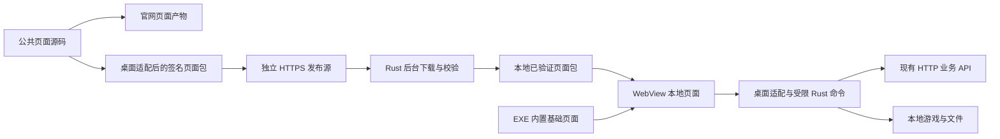

# 页面包独立更新设计与实施约定

更新日期：2026-10-28。

**状态：独立签名页面更新已随 v0.2.0 正式发布，页面渠道继续独立迭代。本文保留设计、信任边界与历史迁移约定；当前发布状态以正式 Release、签名稳定索引和批次回执为准，后文的历史执行指令不作为重放批次的授权。分支及源码归并规则见 [开发流程](DEVELOPMENT_WORKFLOW.md)。**

本文件保存功能、信任边界和发布约定；实现地图见 [当前架构](ARCHITECTURE.md)，本轮任务及验收见 [实施计划](superpowers/plans/2026-10-24-web-and-page-packages.md)。本地检查通过、真实游戏验收与正式发布分别记录。

## 1. 目标与已确认边界

- 日常 HTML/CSS/JavaScript 的展示与交互改动，在兼容既有本地能力和 API 的前提下，只发布页面包，不重新编译和分发 exe。
- 助手先加载本地页面，显示界面后后台检查更新；网络不可达不阻塞打开。
- 业务 API 保持现有 HTTP 部署。页面更新包及其更新清单使用独立 HTTPS 发布源，**不放到现有 HTTP 业务服务器上，也不回退到该服务器下载页面包**。
- 保留 Tauri/Rust、游戏启动、配置、卡组/录像保存、706 脚本与环境资源管理的现有职责。
- 逐步统一网页与桌面共用的页面业务源码，把平台差异集中在适配层。

服务器本期保持 HTTP 直连，不为本项工作安装 Caddy/Tailscale 或调整端口、防火墙。背景见服务端 [HTTPS 部署草案](https://github.com/301zrg/srvprotianti/blob/e6ae5173485ca9f2f8732b7cd3ceba0470e3a35d/docs/CADDY_HTTPS_DEPLOYMENT.md) 和 [当前交接](https://github.com/301zrg/srvprotianti/blob/e6ae5173485ca9f2f8732b7cd3ceba0470e3a35d/docs/PROJECT_HANDOFF.md)。本方案不解决现有 HTTP API 的传输加密问题。

## 2. 改造前基线与入口

调研时本地版本字段为 `0.1.4`；工作区有其他未提交改动，不代表这些改动已发布。恢复本项工作时必须重新核对版本和待发布内容。

当前页面链路是 `web-source/` → `scripts/prepare-pages.mjs` 桌面适配 → `public/` 与 `dist/` → Tauri 编译并嵌入 exe。网页改动要进入助手，需同步页面快照并发布新程序；服务器数据本身无需随 exe 更新。设置页的程序更新检查只提供正式 ZIP 下载入口，由用户手动覆盖。

主要入口：

| 入口 | 与本方案的关系 |
| --- | --- |
| [页面生成器](../scripts/prepare-pages.mjs)、[构建命令](../package.json) | 拆出可独立发布的页面产物，保留桌面适配与检查 |
| [desktop-bridge.ts](../src/desktop-bridge.ts) | 数据请求、下载和本地动作适配；需要明确兼容契约 |
| [Tauri 配置](../src-tauri/tauri.conf.json)、[Rust 入口](../src-tauri/src/lib.rs) | 增加本地页面包加载、启动选择和恢复入口 |
| [API 实现](../src-tauri/src/api.rs) | 保留固定方法/路由白名单，不因页面更新开放任意请求 |
| [现有更新检查](../src-tauri/src/updater.rs) | 只处理程序正式版检查，不能当作现成页面包更新器 |
| [当前发布工作流](../.github/workflows/windows-desktop.yml) | 区分页面包发布与现有 exe/便携 ZIP 发布 |

## 3. 方案取舍

| 方案 | 收益 | 代价与结论 |
| --- | --- | --- |
| 统一源码并自动构建整个助手 | 减少人工同步 | 每次仍需发 exe，不能单独满足目标 |
| 直接加载线上页面 | 页面发布后可直接获得新版 | 首屏依赖网络，还需处理远程页面权限、缓存和桌面适配；不采用 |
| 本地页面包＋后台更新＋内置兜底 | 日常页面独立发布，启动不等待网络 | 增加签名、兼容、缓存和恢复机制；采用 |

“无需更新 exe”仍需要前端构建、验证和发布。只修改或上传官网 HTML，不会自动更新助手；统一发布流程应从明确的源码版本分别生成官网资源和桌面页面包。

## 4. 目标结构

本轮沿用以下职责结构；具体模块与调用见当前架构图。

公共业务负责统计、筛选、翻页、语言和详情导航；网页适配处理浏览器下载与网页版游戏入口，桌面适配处理本地保存、游戏启动和助手设置。无需为此更换前端框架或重写游戏管理模块。

公共源码位于服务端 `plugins/ladder-web/web/`。`scripts/sync-web-source.mjs` 从显式指定的受控源目录同步固定清单，并记录来源提交及源/生成文件 SHA；构建前拒绝生成快照的人工漂移。页面包不承载 exe/DLL、游戏脚本、卡库或玩家配置。

## 5. 加载、更新与恢复原则

1. 首次支持此机制需要发布一次新 exe。旧助手不具备页面包加载能力，无法仅靠网页发布获得该功能。
2. 启动先选择本地兼容且通过校验的页面包；无可用缓存时使用内置基础页面。网络更新不在首屏等待链上。
3. 首次页面 ready 后在后台检查一次独立 HTTPS 更新清单，也可在设置中手动检查。索引请求最多 15 秒，ZIP 请求最多 45 秒；断网继续使用本地页面。
4. 页面包及清单校验通过后，完整写入版本目录；不在当前运行页面目录中逐个覆盖 HTML/JS/CSS。
5. 在下次启动启用，不提供使用中的强制刷新；避免中断输入、认证和文件操作。
6. 一次运行固定使用同一页面版本，防止页面跳转或资源请求混用新旧文件；需验证本地 origin、绝对资源路径、语言存储和 CSP。
7. 保留上一个可用包和 exe 内置包。候选页面启动失败时回退并隔离失败版本，避免反复启用；恢复入口不能依赖失败的新页面。普通 API 断网或返回错误不应直接判定页面包损坏。

缓存位于游戏数据目录的 `page-packages/`。候选在启动前持久化 booting，页面确认 ready 后才成为 active；45 秒未确认或启动异常退出则隔离候选，恢复上一可用包或内置页面。原生菜单和 `Ctrl+Shift+R` 提供“下次启动使用内置页面”，不依赖业务页面。保留当前、候选、上一版和本次固定使用的版本，清理限定在自有缓存目录。已接受的本地包可离线继续使用；网络新清单必须未过期。删除缓存不触及玩家配置、卡组、录像、脚本及环境备份。

## 6. 信任与兼容要求

- HTTPS 验证保持开启；发布签名由程序内置的可信公钥验证，私钥仅留在受控发布环境。普通哈希文件不能替代签名。
- 签名清单覆盖应用标识、渠道、页面版本、所需程序/桥接版本、文件清单与哈希等兼容信息；具体格式、签名库、密钥轮换和过期策略实施前确定。
- 验证下载来源、重定向、长度/展开大小、路径和文件类型，拒绝越界路径与链接文件；未校验内容不得进入 WebView 执行。
- 程序版本与页面版本分别记录。不能满足本地能力或接口要求时，继续使用兼容版本；页面更新不能自行扩大 Rust 权限或 API 白名单。
- 保留已接受版本记录，拒绝未授权的网络降级；本地故障回退是单独的恢复动作。正式撤回坏版本可用更高页面版本重新发布修复或旧内容，避免要求客户端无条件接受旧清单。
- 页面包发布与业务 API 发布有先后关系时，先部署兼容 API，再发布页面；旧程序和旧页面在过渡期仍需获得可理解的降级行为。

## 7. 发布范围

| 改动 | 目标发布方式 |
| --- | --- |
| 文案、样式、筛选、排序、详情链接 | 通常只发页面包；官网对应发布静态资源 |
| 复用既有 API/本地能力的新展示或交互 | 页面包，须通过兼容检查 |
| 兼容的数据或服务端逻辑变化 | 按服务端发布规则处理，不因本方案自动触发 exe 发布 |
| 新 Rust 命令、本地文件/游戏能力、新增未允许的 API 路由 | 更新 exe；必要时配套页面/API |
| Tauri、页面加载器、恢复机制或本地安全修复 | 更新 exe |
| 卡库、706 脚本、游戏程序与其他环境资源 | 沿用各自范围，不混入页面包 |

页面包候选应绑定明确的源码提交和文件清单，通过验证后签名，先发布不可变资源，再发布对应更新清单。页面包、官网、exe 和服务端分别记录发布结果与回退方式，不扫描上传整个脏工作区，也不改变现有已排队发布批次。

采用现有 `301zrg/srvprotianti-desktop` 的独立页面渠道：`pages-v<版本>` Release 存放不可变 ZIP 和签名清单，`page-updates` 分支只发布稳定索引。页面 Release 明确 `make_latest=false`，保持 exe 的 latest 下载入口。玩家网络不可达时保留本地包，不回退 HTTP 来源。

私钥只在本机 Git 忽略目录保存并签名；程序和仓库只保存公钥。维护者应另行安全备份私钥，丢失后不能用当前信任根签新包。CI 读取候选签名清单，以默认分支的可信校验器/公钥认证桌面和官网提交，再检出实际官网提交、核对 Git blob 与同步快照，重建逐字节相同的 ZIP，最后发布资源和索引；CI 不接收私钥。

本机直接使用 `publish-page-package.mjs` 同样必须提供 `--website-root <官网web目录>`，可指定 `--source-directory <桌面web-source>`；实际 Git 来源和本地快照核对通过后，还要将该快照清单的原始字节 SHA/size 与已签 ZIP 内清单对应。全部门禁通过后才读取发布 token 或访问网络。空来源、旧提交冒名、包与本地清单不一致均不能发布；本地 `websiteCommit=null` 的 draft 仅用于开发验证。

## 8. 成本与体验预期

- 启动：目标是不等待网络；本地读取和校验仍有开销，须对比现有版本实测，不能承诺零延迟。
- 网络：更新源慢或不可达时继续使用本地页面，只延迟新版到达；最新房间、排名等仍依赖业务 API。
- 体积：2026-10-23 调研时已有本地 `dist` 约 1.21 MB（未压缩，ExcelJS 约 0.95 MB），仅作规模参考，不是新方案构建或性能验收结果。初期没有必要引入复杂差分更新。
- 维护：新增页面版本、签名密钥、托管、兼容矩阵和恢复机制；不需要在业务服务器增加 TLS 代理或常驻更新服务。
- 验收：构建、签名包、浏览器适配和真实 WebView 的本地验证分别留证；真实游戏和正式 CI/渠道发布仍独立验收，不用本地检查结果替代。

## 9. 交付入口与验收

本轮已经获准实施，继续交付时按以下顺序核对：

1. 阅读本文件与当前 README/架构；核对待处理更新、工作区差异、最新 exe/页面/API 和实际发布状态，保留已有改动。不要自行推断“其他更新已完成”。
2. 定稿公共源码归属、HTTPS 托管与页面发布索引、签名/版本契约、恢复行为和必要的四语用户文案；形成可执行实施计划。
3. 验证页面加载与 Rust 桥接的兼容路径，再实现更新器、源码整合和发布流程；同步实际变更的 DESIGN 与架构图。
4. 在发布前完成下表验收，区分合成检查、Windows 实测、真实游戏和线上验证。首次迁移发布仍需明确发布范围与授权。

| 验收方面 | 必须覆盖 |
| --- | --- |
| 独立发布 | 改动业务页面后只发布页面包，用户 exe 哈希不变且能获得对应功能 |
| 启动 | 无缓存、有缓存、断网、更新源超时；测量首次可交互时间，证明网络不阻塞首屏 |
| 一致性与恢复 | 中断下载/安装、缺文件、损坏包、页面启动失败、磁盘不可写、异常退出；不白屏锁死、不混用版本、不改玩家文件 |
| 信任与兼容 | 错误签名、哈希不符、错误应用/渠道、旧清单、程序过旧、非法路径/超限包；拒绝后旧界面可用 |
| 页面与本地动作 | 四语言八页、设置、查询、导出、卡组/录像保存与打开、游戏启动；保留网页和桌面各自行为 |
| 发布与回退 | 候选/正式渠道、撤回坏版本、程序更新入口不被页面发布污染、源码与资源可追溯 |

## 10. 技术参考

- [Tauri 前端资源配置](https://v2.tauri.app/reference/config/#frontenddist)：本地嵌入与远程/自定义协议的区别。
- [Tauri 2.12 自定义资源协议](https://docs.rs/tauri/2.12.0/tauri/struct.Builder.html#method.register_uri_scheme_protocol)：本地页面包加载的候选实现基础，尚未在本项目验证。
- [Tauri 权限边界](https://v2.tauri.app/security/capabilities/)：页面与本地能力的权限约束。
- [TUF 更新规范](https://theupdateframework.github.io/specification/latest/)：签名、版本和更新元数据有效性的参考；不代表已决定引入整套 TUF。

## 11. 2026-10-24 已批准范围与最新发布边界

维护者已确认以下功能、渠道、签名方式和文案。2026-10-25 最新指令要求准备新批次并启动同一个 cmd，在空闲维护门禁通过后统一发布；此前暂缓指令已撤销。各渠道仍使用独立的固定来源、清单与核验回执。

### 官网入口与设置

- 顶部顺序为“一键匹配、开始游戏、卡组编辑、查看录像”；一键匹配为主要按钮，其余为次要按钮，移除原入口的长副标题。手机采用两列布局，四语一起验证。
- 使用正式网页版 `https://ocg1103nexus.com/` 的 v1 入口：`ladder`、`deck-editor`、`replay-list`；开始游戏打开原首页，介绍页常规联机使用 `regular`。2026-10-24 只读获取的正式站源码标识为 `7cd4321461104c6d40ece790ee89686acf8b4b4d`，施工时还需核对该版本对应的接收端实现。
- 等待中的天梯房提供“点击匹配”，进入 TT 队列，由服务器决定对手；介绍页两个连接板块分别提供“网页联机”和“一键匹配”。
- 同时完成此前讨论的官网设置、账号缓存与“查询自己”。账号默认记住，密码仅在勾选“记住密码”后长期保存，否则限当前标签页；提供清除入口。
- 带账号入口沿用已发布的 `srvprotiantiweb:entry` 消息通道，校验目标来源、窗口、request 与 intent；密码不进入 URL。没有完整账号时使用公开入口，由网页版既有身份或表单接续，不发送不完整凭据。
- 查询排行仅使用账号；玩家战绩复用现有 POST 接口。官网功能不增加后台接口、数据库变更或游戏重启。

### 页面包与首次迁移

- 在现有 `301zrg/srvprotianti-desktop` 仓库增加独立 HTTPS 页面渠道：不可变 `pages-v<页面版本>` 资源、单独的稳定渠道索引；页面发布不得成为现有 exe 的 latest Release。
- 首次迁移推荐程序版本 `0.2.0`、首个页面包 `1.0.0`。玩家需要覆盖安装一次新助手；后续复用已有桥接/API 的页面更新仅发布页面包。正式版本号仍须核对线上已有版本后确定。
- 在本机独立 Git 忽略目录生成和保存 Ed25519 签名私钥，程序只嵌入公钥。私钥不写入文档、输出、提交、页面包或公开发布资源。
- 以服务端 `plugins/ladder-web/web/` 的公共页面为业务源码入口，构建阶段生成桌面适配产物，保留原生游戏、文件保存、导出和设置差异；禁止把未验证的官网页面直接放入具备本地权限的 WebView。
- 页面包清单包含应用/渠道、递增页面版本、桥接兼容范围、文件路径/长度/散列和来源提交；签名验证、受限下载、解压边界检查和完整安装后，才可成为候选。
- 首屏使用已验证本地缓存或内置页面；每次启动后在后台检查一次更新，下载成功于下次启动应用，不在本次使用中强行刷新。保留上一可用页面和内置页面，提供不依赖业务页面的本地恢复入口。
- 新增本地命令或安全边界变化仍需更新 exe。页面包不包含游戏、Lua、卡库、玩家配置或其他本地资源。

### 建议中文文案

沿用前述按钮及“设置、账号、密码、记住密码、保存、清除已保存账号、查询我的天梯排行、查询我的玩家战绩、查询自己”。新增页面更新区域建议使用：

- “页面更新”“当前页面版本”“检查页面更新”。
- “新版页面已下载，将在下次启动时应用。”
- “页面更新暂不可用，继续使用当前版本。”
- “页面更新校验失败，已保留当前版本。”
- “新版页面启动失败，已恢复可用版本。”
- 原生恢复入口：“下次启动使用内置页面”。

四语翻译保持相同含义；错误信息不含凭据。上述文案已随本节一并获准。

### 与正在运行的发布监控的关系

- 已排队 `deck-templates-20261023` 使用固定清单和独立暂存文件；仅修改官网/桌面源码、文档及隔离构建产物，不会改变该批次。
- 观察器每次轮询都会重新发现启用批次；加入新批次或修改公共发布工具前，先停止本机观察器，核对远端协调进程/锁与回执。已在执行的远端切换独立收尾，不强杀。
- 原模板批次 ID、清单、候选文件和回执保持原样。新官网/页面包/迁移版使用独立批次或独立明确发布步骤，不覆盖旧批次，也不扫描上传整个工作区。
- `deck-templates-20261023` 已回滚，不能重放或清空回执；本次使用新批次和新的明确候选，最新授权允许重新启动单实例监控。
- 发布前核对回滚诊断、固定来源和完整门禁；服务器阶段成功后发布迁移 exe 与页面包，页面包使用同一固定桌面提交和真实官网提交。不修改已经发布的 Cloudflare 网页客户端。

正式来源准备顺序为：提交并固定官网源码 → `sync-web-source.mjs --website-root <官网 web 目录> --website-commit <官网提交>` → `npm run check` → 只提交明确审核的桌面文件 → 用该桌面提交和官网提交构建并签名页面包。页面制品不进入桌面源码提交，私钥不进入发布队列。直接发布调用 `publish-page-package.mjs` 时必须同时指定已签清单、ZIP、公钥、桌面提交、真实官网目录和桌面 `web-source` 目录；监控只能发布已固定且核验散列的制品。

验收沿用第 9 节，并增加官网四语/手机入口及跨窗口交接检查，以及“官网页面改动后只更新页面包、exe 散列保持不变”的真实本地演练。真实账号登录、正式天梯匹配与真机验收分别记录，不以合成检查替代。
